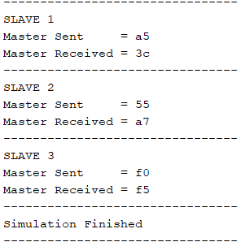

# SPI Master with Three Slaves (Verilog)

Verilog HDL implementation of an SPI master-slave communication system: one SPI master and three
SPI slaves with dedicated chip-select lines, full-duplex serial transfer over MOSI/MISO, and a
simulation testbench with waveform verification in Xilinx Vivado.[cite: 4]

---

## 📌 Overview

SPI (Serial Peripheral Interface) is a synchronous, full-duplex serial protocol.[cite: 4] The master drives
the clock (SCLK) and sends data on MOSI while simultaneously receiving data from the selected slave
on MISO.[cite: 4] Each slave has its own chip-select (CS) line, so the master talks to one slave at a time.[cite: 4]

This project connects one master to three slaves over shared MOSI, MISO and SCLK lines.[cite: 4]

## ✨ Key Features

- **One SPI master, three SPI slaves** with individual chip-select lines (`CS0`, `CS1`, `CS2`).[cite: 4]
- **Full-duplex 8-bit transfers:** one bit out on MOSI and one bit in on MISO every clock.[cite: 4]
- **Slave selection** through a `slave_select` input; only the chosen slave is active.[cite: 4]
- **3-state FSM** in the master: `IDLE → TRANSFER → FINISH`.[cite: 4]
- **Reusable slave module** instantiated three times, each with its own predefined response byte.[cite: 4]
- **MISO multiplexer** in the top module so only the selected slave drives the master's MISO input.[cite: 4]
- **`done` flag** asserted when a transfer completes.[cite: 4]

## 🗂️ Repository Structure

| Path | Description |
|------|-------------|
| `Design Sources/spi_master.v` | SPI master: clock generation, chip-select control, shift logic, 3-state FSM |
| `Design Sources/spi_slave.v` | Generic SPI slave, instantiated three times |
| `Design Sources/spi_top.v` | Top module: connects the master, three slaves and the MISO multiplexer |
| `Simulation Sources/tb_spi.v` | Testbench that runs one transfer with each slave |
| `Output Wave forms.png` | Waveform from the simulation |
| `Result.png` | Console output of the received data |

## ⚙️ How It Works

1. **Start:** the master receives a `start` signal, 8-bit input data and a `slave_select` value.[cite: 4]
2. **Select:** based on `slave_select`, the master pulls one of `CS0`, `CS1` or `CS2` low.[cite: 4] The other
   slaves stay inactive.[cite: 4]
3. **Transfer:** the master generates SCLK.[cite: 4] On each clock it sends one bit on MOSI and receives one
   bit from the selected slave on MISO (full-duplex).[cite: 4]
4. **Finish:** after eight bits, the master releases chip select, stops the clock, stores the
   received byte in its output register, and asserts `done`.[cite: 4] The FSM returns to `IDLE`.[cite: 4]

### Master FSM

| State | Behavior |
|-------|----------|
| `IDLE` | Waits for the `start` signal |
| `TRANSFER` | Serial communication takes place |
| `FINISH` | Transfer completes, then returns to `IDLE` |

### Slave responses

| Slave | Byte returned on MISO |
|-------|-----------------------|
| Slave 1 | `0x3C` |
| Slave 2 | `0xA7` |
| Slave 3 | `0xF5` |

## 🧪 Simulation

The testbench generates the clock, applies reset, then performs three transfers:[cite: 4]

| Transfer | Slave | Master sends | Master receives |
|----------|-------|--------------|-----------------|
| 1 | Slave 1 | `0xA5` | `0x3C` |
| 2 | Slave 2 | `0x55` | `0xA7` |
| 3 | Slave 3 | `0xF0` | `0xF5` |

The received data is printed in the Vivado console, confirming that the master communicates with
the selected slave and ignores the inactive ones.[cite: 4]

**Run in Xilinx Vivado**

1. Create a new RTL project and add `spi_master.v`, `spi_slave.v` and `spi_top.v` as design sources.[cite: 4]
2. Add `tb_spi.v` as a simulation source and set it as the simulation top.[cite: 4]
3. Click **Run Simulation → Run Behavioral Simulation**.[cite: 4]
4. Inspect `MOSI`, `MISO`, `SCLK`, the chip-select lines and `done` in the waveform window.[cite: 4]

### Results

## 🛠️ Tools

- Verilog HDL[cite: 4]
- Xilinx Vivado (behavioral simulation)[cite: 4]

## 🔧 My Contributions

_Fill in only what you have actually built and tested yourself, for example:_[cite: 4]

- [ ] Added support for SPI modes 0 to 3 (CPOL/CPHA)[cite: 4]
- [ ] Parameterized the data width[cite: 4]
- [ ] Added a clock divider for configurable SCLK frequency[cite: 4]
- [ ] Added a self-checking testbench with pass/fail output[cite: 4]
- [ ] Added extra test cases (back-to-back transfers, reset during transfer)[cite: 4]

## 🚧 Possible Future Work

- Multiple SPI modes (CPOL/CPHA)[cite: 4]
- Variable data widths[cite: 4]
- Clock division for adjustable SCLK[cite: 4]
- Error detection mechanisms[cite: 4]
